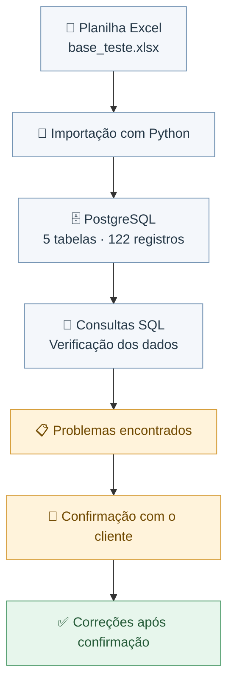

# Parte 4 — Conferência dos Dados e Reunião com o Cliente

**Período de referência:** Fevereiro de 2025

**Objetivo:** apresentar os resultados da integração dos dados, mostrar os problemas encontrados e confirmar com o cliente quais informações precisam ser corrigidas.

> [!NOTE]
> A importação foi concluída com 122 registros. Porém, isso não garante que todos os valores estejam corretos. Por isso, realizamos a validação.

---

## Visão rápida do processo

### Dados utilizados

As informações vieram da planilha `dados/base_teste.xlsx` e foram importadas para cinco tabelas do PostgreSQL.

| Tabela do banco | O que armazena | Registros |
| --- | --- | ---: |
| `fornecedor` | Informações dos fornecedores | 20 |
| `produtos_filial` | Produtos cadastrados nas filiais | 20 |
| `pedido_compra` | Pedidos feitos aos fornecedores | 29 |
| `entradas_mercadoria` | Mercadorias registradas como recebidas | 20 |
| `venda` | Vendas realizadas | 33 |
| **Total** | **Registros importados** | **122** |

**Conferência:** as quantidades no banco correspondem às linhas principais da planilha Excel.

---

## 1. Pontos principais para validar

Nesta etapa, apresentamos as informações que precisam ser confirmadas com a empresa.

### 1.1 Recebimentos acima do que foi pedido

Comparamos a quantidade solicitada em `pedido_compra` com a quantidade registrada em `entradas_mercadoria`.

| O que encontramos | Pergunta ao cliente |
| --- | --- |
| **7 casos** com recebimento maior que o pedido. | A empresa costuma receber mais mercadorias do que solicita? |
| O produto **P2** teve **14 unidades pedidas** e **64 registradas como recebidas**. | Essas 64 unidades realmente chegaram ou houve erro no registro? |

**Exemplo — Produto P2**

| Informação | Quantidade |
| --- | ---: |
| Unidades pedidas | 14 |
| Unidades registradas como recebidas | 64 |
| **Diferença** | **+50** |

➡️ **Ponto a confirmar:** por que o recebimento registrado foi maior que o pedido?

### 1.2 Diferenças entre entrega e recebimento

Verificamos se a quantidade informada como entregue no pedido corresponde ao registro de entrada da mercadoria.

| O que encontramos | Pergunta ao cliente |
| --- | --- |
| **18 registros** com quantidades diferentes. | Os dois campos deveriam mostrar a mesma quantidade? |
| No produto **P1**, o pedido informa **10 unidades entregues**, mas a entrada registra **77 recebidas**. | Qual registro devemos usar como referência? |

➡️ **Ponto a confirmar:** o significado das quantidades em cada tabela.

### 1.3 Ordens de compra zeradas

Analisamos os pedidos que possuem o campo `ordem_compra` com valor zero.

| O que encontramos | Pergunta ao cliente |
| --- | --- |
| **11 pedidos** com ordem de compra igual a zero. | O valor zero tem algum significado para a empresa? |
| Os casos aparecem nos pedidos de **ID 19 até 29**. | Esses pedidos estão incompletos ou foram registrados dessa forma de propósito? |

➡️ **Ponto a confirmar:** se as ordens precisam ser corrigidas.

### 1.4 Datas que precisam de conferência

Comparamos as datas dos pedidos com as datas registradas para entrega.

| O que encontramos | Pergunta ao cliente |
| --- | --- |
| **20 registros** com data de entrega anterior à data do pedido. | Essas datas estão corretas? |
| No pedido **12**, produto **P12**, a compra aparece em **25/02/2025**, mas a entrega consta em **20/02/2025**. | Essa data representa uma entrega realizada ou uma previsão? |

➡️ **Ponto a confirmar:** o significado e a correção das datas.

### 1.5 Produtos sem cadastro correspondente

Verificamos se os produtos vendidos aparecem cadastrados na tabela `produtos_filial`, considerando a mesma filial.

| O que encontramos | Pergunta ao cliente |
| --- | --- |
| **13 registros de venda** sem produto correspondente no cadastro da filial. | Esses produtos deveriam estar cadastrados? |
| Os casos foram identificados na tabela `venda`. | Pode ter ocorrido algum erro no cadastro ou no código do produto? |

➡️ **Ponto a confirmar:** se faltam produtos no cadastro das filiais.

### 1.6 Entradas sem pedido correspondente

Comparamos as entradas de mercadorias com os pedidos de compra existentes.

| O que encontramos | Pergunta ao cliente |
| --- | --- |
| Entrada da **ordem 19**, produto **P19**, nota **NFE19**. | Existe algum pedido relacionado a essa entrada? |
| Entrada da **ordem 20**, produto **P20**, nota **NFE20**. | Essa mercadoria foi recebida sem pedido ou houve erro no registro? |

**Resultado:** 2 entradas sem correspondência encontrada nas ordens de compra e produtos registrados.

➡️ **Ponto a confirmar:** a qual pedido cada entrada pertence.

### 1.7 Colunas adicionais na planilha

Durante a importação, encontramos informações extras na aba `pedido_compra` do Excel.

| O que encontramos | Pergunta ao cliente |
| --- | --- |
| **11 colunas adicionais**, com informações preenchidas em **9 linhas**. | Essas colunas fazem parte da planilha oficial? |
| No pedido **21**, produto **P12**, os valores das colunas principais são diferentes dos valores extras. | Qual conjunto de informações deve ser considerado correto? |

**Exemplo do pedido 21**

| Informação | Colunas principais | Colunas adicionais |
| --- | ---: | ---: |
| Ordem de compra | 0 | 12 |
| Quantidade pedida | 12 | 91 |
| Quantidade entregue | 0 | 48 |

➡️ **Ponto a confirmar:** se os dados adicionais devem complementar ou substituir os principais.

> [!IMPORTANT]
> Nenhum desses valores deve ser alterado sem confirmação do cliente. Primeiro precisamos descobrir qual informação está correta.

---

## 2. Como a validação foi feita

Utilizamos consultas SQL para comparar as informações do banco e identificar possíveis problemas.

| Técnica | Como foi utilizada | Para que serve |
| --- | --- | --- |
| **Conferência de quantidades** | Comparação entre pedidos e recebimentos | Encontrar diferenças nos valores |
| **Cruzamento de tabelas** | Comparação entre tabelas relacionadas | Encontrar registros sem correspondência |
| **Conferência de datas** | Comparação entre pedido e entrega | Identificar datas suspeitas |
| **Análise da planilha** | Verificação das colunas adicionais do Excel | Encontrar informações fora do padrão |
| **Validação com o cliente** | Perguntas sobre os resultados | Confirmar quais dados estão corretos |

### Como funciona a conferência

**1.** Consultamos as informações no banco.

**2.** Comparamos os registros das tabelas relacionadas.

**3.** Se encontramos alguma diferença, registramos o caso.

**4.** Apresentamos o problema ao cliente para confirmar o que aconteceu.

---

## 3. Consultas preparadas para a reunião

As seis consultas foram implementadas e executadas no arquivo [`sql/04_validacao.sql`](../sql/04_validacao.sql).

| Consulta | O que verifica | Resultado |
| --- | --- | ---: |
| **Consulta 1** | Recebimentos maiores que os pedidos | **7 registros** |
| **Consulta 2** | Diferenças entre quantidades entregues e recebidas | **18 registros** |
| **Consulta 3** | Pedidos com ordem de compra zerada | **11 registros** |
| **Consulta 4** | Datas de entrega anteriores às datas dos pedidos | **20 registros** |
| **Consulta 5** | Produtos vendidos sem cadastro correspondente na filial | **13 registros** |
| **Consulta 6** | Entradas de mercadoria sem pedido correspondente | **2 registros** |

**Exemplo:** a Consulta 1 identificou o produto P2, com 14 unidades pedidas e 64 registradas como recebidas.

As consultas apenas verificam os dados. Elas não alteram os registros do banco.

---

## 4. Resumo dos resultados

| Indicador | Quantidade encontrada |
| --- | ---: |
| 📦 Recebimentos acima dos pedidos | **7** |
| 🔄 Quantidades entregues e recebidas diferentes | **18** |
| 🧾 Ordens de compra zeradas | **11** |
| 📅 Datas que precisam de conferência | **20** |
| 🏷️ Vendas sem produto cadastrado na mesma filial | **13** |
| 🚚 Entradas sem pedido correspondente | **2** |

> **Observação:** um mesmo registro pode aparecer em mais de uma verificação. Por isso, os números não devem ser somados como se fossem problemas independentes.

---

## 5. Erros e inconsistências encontrados nos dados

Esta tabela reúne os resultados das consultas executadas.

| Tabela analisada | Problema encontrado | Quantidade | Evidência |
| --- | --- | ---: | --- |
| `pedido_compra` + `entradas_mercadoria` | Recebimento maior que o pedido | **7** | Consulta 1 |
| `pedido_compra` + `entradas_mercadoria` | Diferença entre entregue e recebido | **18** | Consulta 2 |
| `pedido_compra` | Ordem de compra igual a zero | **11** | Consulta 3 |
| `pedido_compra` | Data de entrega anterior ao pedido | **20** | Consulta 4 |
| `venda` + `produtos_filial` | Venda sem produto cadastrado na filial | **13** | Consulta 5 |
| `entradas_mercadoria` + `pedido_compra` | Entrada sem pedido correspondente | **2** | Consulta 6 |
| Excel — aba `pedido_compra` | Colunas adicionais com informações diferentes | **9 linhas** | Conferência do Excel |

**Importante:** os resultados das seis consultas foram obtidos na base importada, incluindo registros de outros meses. Fevereiro de 2025 é o período de referência da reunião, não um filtro aplicado a todas as verificações.

A análise das colunas adicionais foi feita diretamente no Excel, pois elas não foram incluídas na importação principal.

---

## 6. Encaminhamento da reunião

Após apresentar os resultados, precisamos definir com o cliente quais informações estão corretas e quais precisam de ajuste.

| Etapa | O que será feito |
| --- | --- |
| **1. Apresentar** | Mostrar os problemas encontrados nas consultas |
| **2. Confirmar** | Ouvir a explicação do cliente |
| **3. Conferir** | Comparar os dados com pedidos e notas fiscais |
| **4. Definir** | Identificar quais registros precisam ser corrigidos |
| **5. Registrar** | Documentar as decisões e os ajustes necessários |

### Resultado esperado

A importação dos dados foi concluída e as consultas estão funcionando.

Agora, a confirmação das informações com o cliente permitirá corrigir possíveis erros com segurança e melhorar a confiabilidade dos relatórios de compras, vendas e estoque.
